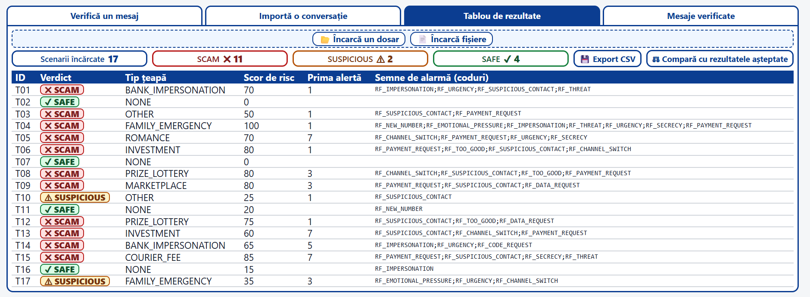

# 2nd Eye (Scam Shield) by AlgoR3IthM

A local, privacy-first scam detector for elderly Romanian speakers: it reads WhatsApp, Gmail or pasted messages, scores them
message by message and shows a plain-Romanian warning. It comes in two halves: a **laptop app** (this folder: web UI, WhatsApp/Gmail
watchers, desktop alerts, Qwen3-4B in LM Studio) and a **mobile app** ([`mobile/`](mobile): Android, reads WhatsApp on the phone and
shows a full-screen alert, with a fine-tuned small Qwen model `scamshield-3b` that can run on the phone). Built in one day at the Scam Shield hackathon (19 November 2026) by
**[raduedu](https://github.com/raduedu), [mara488](https://github.com/mara488) and [Moghedien-ux](https://github.com/Moghedien-ux)**,
equal co-authors (see [AUTHORS.md](AUTHORS.md)). Released under the [MIT License](LICENSE).

## Demo: Secret Test Set results

Our submitted run on the organisers' Secret Test Set (T01–T17): **11 SCAM, 2 SUSPICIOUS, 4 SAFE**, each flagged scenario with a
scam type and the first message where the running score reaches 25. We never received the official expected labels, so no
accuracy figure is claimed. Raw output: [`demo/test_set_results.csv`](demo/test_set_results.csv).
Open [`demo/index.html`](demo/index.html) in a browser for a small interactive version (filter by verdict, click a scenario to see
its red flags in the app's own Romanian wording). It needs no server, no model and no scenario text.

## Docs

- [docs/MOBILE.md](docs/MOBILE.md): the Android app, its engine, the `scamshield-3b` model and its training data, known gaps.
- [docs/TRAINING.md](docs/TRAINING.md): the QLoRA fine-tune of the laptop model, what ran and why it was not shipped.
- [docs/DATASETS.md](docs/DATASETS.md): every dataset, its source, and which ones were kept out of training.
- `PLAN.md` (design contract and scoring), `PITCH.md` (presentation), `MERGE.md` (merging with the Android work).

## Run

**Double-click `START.bat`.** That is all. The first time it sets up what is missing (Python environment, asks for the
Gmail address and app password, opens a window to link WhatsApp once). Every time it loads the local model, starts the
detector, the WhatsApp and Gmail watchers and the full-screen alert, and opens http://localhost:8000.
**`STOP.bat`** stops everything. Logs (verdicts and counts only, never message text) are in `%TEMP%\2ndeye`.

Other ways to start:
1. `run.bat` starts only the model and the web app (no watchers): use this for the jury's Test Set dashboard.
2. From a phone on the same Wi-Fi open `http://<laptop-ip>:8000` to check or import messages. The "Mesaje verificate" tab
   (`/api/live`, real WhatsApp/Gmail text) answers only the browser on the laptop itself; other devices get 403.
3. Without the LLM: open `/` and the app still works (rules + link/number checks); the API takes `?use_llm=false`.

Settings (environment variables): `SCAMSHIELD_MODEL` (default `qwen/qwen3-4b-2507`, 4B, about 2 s per scenario on the RTX 3080; 11 validation scenarios in 26 s measured on 19.11 with one slot and an 8192 context; results identical across 3 runs), `SCAMSHIELD_LLM_URL` (default `http://localhost:1234`, must be localhost), `SCAMSHIELD_GPU`, `SCAMSHIELD_CTX`.
Manual start: `.venv\Scripts\python.exe -m uvicorn backend.server:app --host 0.0.0.0 --port 8000 --no-access-log`.

## Architecture

- `web/index.html`: GUI and results dashboard (one self-contained file, no CDN).
- `backend/server.py`: FastAPI, `/api/analyze`, `/api/analyze-text`, `/api/health`, `/api/catalog`; one analysis at a time.
- `backend/fusion.py`: ensemble, official scoring formula, verdict, first alert.
- `backend/rules.py`: Romanian intent rules (Signal A).
- `backend/contacts.py`: links and numbers against the official catalog (Signal B).
- `backend/llm.py`: local LLM (Signal C) via LM Studio, JSON-schema output, evidence quotes validated against the text.
- `backend/patterns.json`: Romanian example patterns retrieved into the LLM prompt by token overlap.
- `backend/warnings_ro.py`: fixed Romanian warning templates (the LLM never writes warnings).
- `integrations/`: Telegram forwarding bot and WhatsApp Web browser extension, both calling this local API.
- Deterministic: temperature 0, top_k 1, seed 42, no randomness, so a re-run gives the same table. LM Studio's prompt cache can change the first tokens of an otherwise identical request, so `llm.py` sends each prompt once with `max_tokens=1` first, which makes the answer independent of what was analysed before. A failed LLM call is retried twice; if it still fails the result says `signals.llm_status: "unavailable"` and `/api/health` shows `llm: false`.
- Check it: `python backend/evaluate.py --repeat 5` (and `--selftest --repeat 5`) runs every scenario five times and lists any field that differs (ids and field names only).

## Does any message leave your laptop?

No. Analysis runs on this laptop only: the API listens on the local network, and the only outbound connection from the detector is to LM Studio on `localhost:1234` (the code refuses any other host). No cloud AI is used at runtime, no message text is logged or written to disk, and there are no analytics or external fonts/CDNs. The server keeps a small in-memory result memo (at most 256 results, keyed by a SHA-256 of the scenario, the model id and the options) so that the same scenario analysed twice in one session returns the identical result. It lives in RAM only, is never written to disk, disappears when the server stops, and `DELETE /api/memo` clears it at any time. The Telegram bot, if used, only receives messages the user forwards to it and sends them to this same local API.

Access rules (since 2026-11-23): cross-origin reads are allowed only from the app's own page on `localhost`/`127.0.0.1` and from
browser extensions, so other websites open in the browser cannot read the API; the live-conversation feed `/api/live` additionally
answers only loopback requests with a loopback `Host` (blocks other devices and DNS rebinding). The check endpoints have no password,
so anyone on the same Wi-Fi can submit text for analysis; use it on a trusted home network.

## Jury checklist (the 10 minutes before our slot)

1. Stop the live watcher and notifier so nothing else uses the model while the dashboard is built:
   `Get-CimInstance Win32_Process | ? { $_.CommandLine -match 'watcher\.py|notifier\.py' } | % { Stop-Process -Id $_.ProcessId -Force }`
2. Close any running API window, then double-click `run.bat`. It always reloads the model with one slot and an 8192 context
   (`lms ps` must show PARALLEL 1, CONTEXT 8192), then opens http://localhost:8000. The status dot must say the model is on.
3. Copy the Test Set folder somewhere outside the repo (never into Cerinte/, never into any AI assistant).
4. Tab "Tablou de rezultate" -> load the whole folder in one action -> wait for all rows -> "Export CSV" as a backup.
5. Do NOT restart the server until the presentation is over: inside one server session the same file always returns
   the same result, so the jury's live re-run matches the dashboard row.
6. Live re-run: tab "Verifică un mesaj" -> "Deschide fișier" -> the file the jury picks -> show the detail.
7. Hands-on: the juror pastes into "Verifică un mesaj"; a pasted conversation goes into "Importă o conversație".
8. If LM Studio dies on stage the app keeps working on rules and link checks only (status dot turns yellow); say so.
